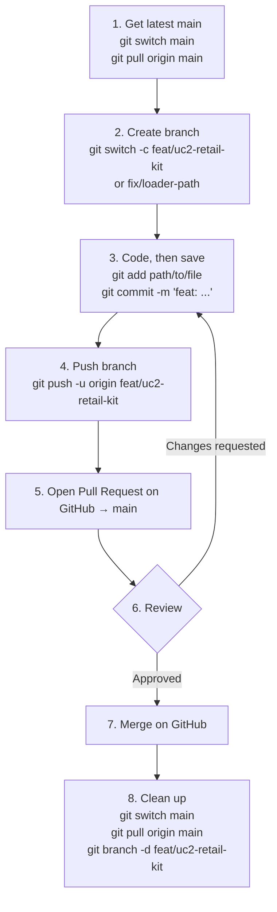

# Git How-To

**Rule #1: never commit or push to `main`.** Every change goes through a branch and a Pull Request (PR).

## Workflow



## Branch names

| Type | Pattern | Example |
|---|---|---|
| New work | `feat/<uc>-<short-desc>` | `feat/uc2-retail-kit` |
| Bug fix | `fix/<short-desc>` | `fix/loader-path` |
| Docs only | `docs/<short-desc>` | `docs/git-how-to` |

Use lowercase, with words separated by `-`. Commit messages start with `feat:`, `fix:`, `docs:`, `refactor:` or `chore:`.

## 1. Get the latest `main`
```
git switch main
git pull origin main
```

## 2. Create a branch (always from an up-to-date `main`)
```
git switch -c feat/uc2-retail-kit
```

## 3. Save your work
```
git status                      # see what changed
git add path/to/file.sql        # one file
git add dbt_demokit_pro/models  # or a whole folder
git commit -m "feat: add uc2 retail kit tables"
```
Run `git status` before every commit. Avoid `git add .`, because it stages everything.

## 4. Push your branch and open a PR
```
git push -u origin feat/uc2-retail-kit   # first push
git push                                 # later pushes
```
Then open a Pull Request on GitHub, targeting `main`. When it's approved, merge it on GitHub.

## 5. Fix review comments
Make the changes, then:
```
git add path/to/file
git commit -m "fix: address review comments"
git push
```
The PR updates automatically.

## 6. Update your branch when `main` has moved on
```
git switch main
git pull origin main
git switch feat/uc2-retail-kit
git merge main
```
If there are conflicts: fix the files, then `git add <file>` and `git commit`.

## 7. After the PR is merged
```
git switch main
git pull origin main
git branch -d feat/uc2-retail-kit
```

## Quick fixes

| Situation | Command |
|---|---|
| Discard changes to a file (not committed) | `git restore path/to/file` |
| Unstage a file | `git restore --staged path/to/file` |
| Put work aside to switch branches | `git stash` → later `git stash pop` |
| Committed on `main` by mistake (not pushed yet) | `git switch -c feat/my-work` → `git switch main` → `git reset --hard origin/main` |

The last fix moves your commits onto a new branch, then resets local `main` to match GitHub. Use it only **before** you push.
